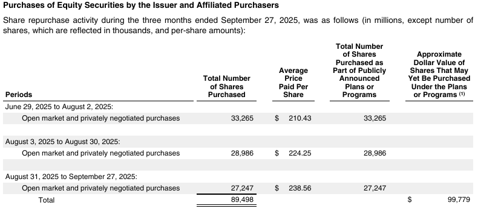
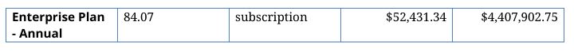

# Selecting document parsing and extraction tools

Choose a parsing and extraction configuration that meets the application's quality
requirements at the lowest total operating cost. Make that choice against the
documents and task the system will actually handle. Public benchmarks provide
valuable evidence for selecting candidates; a deployment decision also needs to
account for the required outputs, integration, review workload and operating limits.

A financial-reporting team may need every table value attached to the correct
period, entity and unit. A legal team may need clause hierarchy, exceptions and
cross-references preserved. An engineering team may need relationships in a diagram
as well as text. These requirements determine which capabilities to compare and
what counts as an acceptable result. The highest overall leaderboard score need
not identify the most economical configuration that meets them.

This guide explains how to use existing benchmark evidence and when additional
evaluation is justified. The [supporting assessment](publication/evidence.html#public-benchmarks)
records source revisions, coverage observations and limits. Sources were reviewed
on October 19, 2026; this revision uses public documentation and retained results,
with no new parser or benchmark execution.

## Define the output the application needs

Parsing produces a usable representation of a document: text, reading order,
tables, headings, images and, where supported, source coordinates. Structured
extraction returns information requested by a schema, such as parties, dates,
amounts and repeated records. Some products perform both operations within one
service. Others expose an intermediate representation that a separate extractor
uses.

The distinction affects evaluation. A parser can preserve two adjacent address
blocks while an extractor assigns the wrong party. An extractor may correctly
return a requested total even when the intermediate representation contains
formatting errors. Inspecting parsing quality helps diagnose either outcome;
measuring the requested task establishes whether the configured combination works.

Define success in terms the receiving application can check. An amount may need
its currency, unit and effective period. A repeated record may need all its fields
associated correctly. A reviewer may need evidence on the original page. An absent
value, an unreadable value and a value that does not apply can require different
outputs.

| Application requirement | Capability to evaluate | Consequential failure |
|---|---|---|
| Search and quote passages | Text, boundaries and reading order | A quotation joins unrelated columns or omits an exception |
| Reconcile financial schedules | Table structure, units and complete records | Correct numbers are attached to the wrong headers |
| Extract contractual terms | Hierarchy, cross-references and requested fields | An exception or amendment is separated from the term it qualifies |
| Interpret technical documents | Tables, formulas and drawn relationships as required | A label survives while its connection to another element is lost |
| Review extracted facts | Value correctness and source evidence | A plausible answer points to the wrong passage |

These are application requirements to investigate, not claims that public
benchmarks omit those capabilities. Establish the relevant deployment constraints
too: supported formats, permitted hosting, document size, volume and turnaround.
A candidate that cannot satisfy a necessary constraint can leave the shortlist
before any quality experiment.

## Use public benchmarks for the capabilities they measure

ParseBench, ExtractBench and ExtractBench Pro come from LlamaIndex; OmniDocBench
provides another set of parsing references and document conditions. Their tasks
and counting units differ.

| Resource | Evaluated task | Useful role in selection |
|---|---|---|
| [ParseBench](https://github.com/run-llama/ParseBench) | Recover document content, structure and source regions across five dimensions | Compare parsing capabilities and inspect relevant page conditions |
| [ExtractBench](https://github.com/run-llama/ExtractBench/tree/56b8fdd91b2cf3648caf75c717c68441ecf4d43f) | Return schema-guided values, records and evidence from complete documents | Compare requested information extraction, including long-document completeness |
| [ExtractBench Pro](https://huggingface.co/datasets/llamaindex/ExtractBenchPro/tree/4ae1ffe48696297a8f6c9153034b3914fc7763d0) | Extract values requiring document-specific interpretation, calculation or visual relationships | Stress relevant extraction and reasoning requirements |
| [OmniDocBench](https://github.com/opendatalab/OmniDocBench/tree/f133a71e9e91c3621c7ce8994200a7b394a06eb3) | Recover text, tables, formulas, layout and reading order across document attributes | Inspect relevant technical, layout and language conditions |

### ParseBench assesses several distinct parsing capabilities

ParseBench reports tables, charts, content faithfulness, semantic formatting and
visual grounding. Reading order contributes to the content evaluation; heading
hierarchy contributes to formatting. They are not additional headline dimensions.
An application requiring a navigable table of contents should check the relevant
annotations and output contract rather than infer a complete navigation test.

The retained source inventory accounts for 2,078 input paths and 2,553
capability-group cases. Most inputs are individual pages. Those counts are not
2,078 independent complete business documents. The
[filterable inventory](publication/evidence.html#inventory) exposes formats, source
hashes, groups, challenge tags and observations. The linked assessment distinguishes
full mechanical coverage from visual inspection of 221 inputs.

Use the [published dimension results](https://github.com/run-llama/ParseBench/blob/d423e529ae329317bcd33c650b367acfb60e6620/leaderboard.csv)
to identify suitable configurations. A content average is not the proportion of
wholly correct documents. Chart spot checks do not establish reconstruction of
every figure or diagram. A combined score assigns weights that may differ from
the application's priorities.

### ExtractBench assesses requested information and completeness

The pinned ExtractBench documentation reports 370 documents and 4,869 pages across
67 document types, including 325 real documents and 45 synthetic long-list
examples. Its schema-guided task, value scoring, record alignment and evidence
requirements are closer to a requested information product than to general
page-to-Markdown conversion.

Its short, medium and long document slices can help reveal whether an extraction
system returns the required records throughout a document. Inspect recall beside
precision. A small set of correct returned values can conceal many omissions.
Whether its schemas and record definitions match the intended application still
requires inspection. These counts and construction details are upstream reports,
not an independent reference audit.

### ExtractBench Pro extends the interpretation challenge

Pro uses the same evaluation framework with 100 synthetic documents. Its six
challenge groups cover document conventions, organization-specific vocabulary,
counting rules, drawn relationships, charts within documents and long chart
sheets. The [dataset card](https://huggingface.co/datasets/llamaindex/ExtractBenchPro/blob/4ae1ffe48696297a8f6c9153034b3914fc7763d0/README.md)
describes fictional values established before rendering. Public evaluation
therefore already includes problems that might otherwise appear to justify
creating new examples.

The [Pro announcement](https://www.llamaindex.ai/blog/introducing-extractbench-pro)
also reports the proportion of documents with perfect value F1 beside aggregate
value and grounding scores. Perfect value F1 is a stricter value-completeness
measure; it does not by itself require correct citations or satisfy every business
acceptance rule. Difficult synthetic examples expose capabilities, but do not
estimate their prevalence in a particular organization's incoming documents.

### Inspect the method behind the score

These resources publish data and evaluation code, which makes their task
contracts inspectable. Their release dates and scope should travel with any
comparison. ParseBench launched in April 2026, ExtractBench in August, and Pro in
October. Recent availability does not establish independent validation or stable
provider rankings.

Check how expected answers were constructed, which cases a score includes, the
metric's treatment of missing values and the exact evaluated configuration.
Vendor-produced evidence is useful when those details support the intended
comparison. Credit it without treating a vendor's headline as an application
acceptance test. A same-named local wrapper can expose different options or outputs.

## Match the evidence to the document collection

An industry label gives insufficient detail for a selection decision. Financial
reports can contain narrative pages, scans, dense schedules and charts. A law
firm's work may involve signed agreements, amended clauses or image-only exhibits.
An engineering collection may combine manuals, calculations and large drawings.
Record which conditions occur, their volume and the cost of getting them wrong.

Compare those conditions with actual public cases and their annotations. Useful
matches include structure, capture quality, language, document length, relevant
facts and the required representation. Unknown metadata remains unknown. An
unrecognized family label in an automatic inventory does not establish that the
benchmark lacks the family.

Public results may already support a shortlist. Separately reported slices or
retained case results may support a more relevant comparison. When the necessary
configuration, schema or delivered representation differs, an additional acceptance
check may be justified. Collect new references only for the unresolved requirement.
A stricter aggregate over existing annotations can sometimes answer the question
without another corpus.

A targeted assessment should distinguish a demonstrated mismatch from an
unexamined condition. The available inspection establishes neither a percentage
of all business use cases covered nor a general coverage failure. An application
can fit public evidence well even though its internal documents are unavailable
to benchmark authors.

## A worked selection: share-repurchase records with source evidence

Consider a financial-analysis workflow that needs one record per reporting period,
with the share count, average price and supporting source location. The example
uses an actual [Apple filing page retained in ParseBench](publication/evidence.html#financial).
The workflow requirements below are illustrative; the page, annotations and saved
parser outputs are retained evidence.

<figure id="financial-source">

<figcaption>Source excerpt: Apple 2025 Form 10-K, printed page 19. ParseBench names the input Apple 10-k_page22.pdf. The complete page and annotation are linked in the evidence appendix. Scroll horizontally to inspect the original at readable size on a phone.</figcaption>
</figure>

The introductory sentence gives different units for different columns. For the
first period, the required normalized record would contain:

| Required field | Accepted value for this source example |
|---|---|
| Period | June 29 through August 2, 2025 |
| Shares purchased | 33,265,000 shares, from 33,265 stated in thousands |
| Average price per share | $210.43 |
| Supporting source | This row, its headers and the unit sentence on the same page |

The application must also distinguish the period rows from the total. All three
periods must be returned, with no duplicate records or invented price for the total.
An output of 33,265 without its scale fails the declared contract even though the
printed digits are correct. The source location must support the number and its
interpretation.

**What the existing benchmark supplies.** The public table reference includes
33,265 and the relevant column header. Its expected HTML does not include the
unit sentence above the table. Table scoring can therefore inform candidate
selection without certifying the normalized share count required here. Content
and grounding evidence are relevant too. This example already exists publicly;
creating another financial-table corpus is unnecessary to explain the requirement.

**Which candidates merit inspection.** The pinned published leaderboard gives the
following aggregate scores on its evaluated population:

| Published configuration | Tables, score out of 100 | Visual grounding, score out of 100 |
|---|---:|---:|
| Azure Document Intelligence (Layout) | 86.00 | 73.78 |
| LlamaParse Agentic | 88.88 | 84.25 |

These are two candidates for output-contract verification, selected to illustrate
comparison across suppliers. The table is not a complete shortlist or an Apple-page
result. The [dated source snapshot](publication/evidence.html#candidates) identifies
the exact leaderboard rows. Published aggregates do not establish either candidate's
accuracy on this schema or its current configuration's operating cost.

**The decision supported now.** Keep those two configurations for a check of the
required record and source evidence. The retained Markdown-only local integration
cannot supply the required coordinate sidecar, so it cannot be deployed unchanged
for this workflow. That interface finding does not establish a limitation of every
underlying parser SDK.

The remaining acceptance check is specific: obtain all three period records,
correctly scaled, with their supporting regions; check the total is handled as
declared; then compare complete-workflow cost and review needs on representative
reports. That check has not been run. Existing evidence justifies a targeted
comparison of the configured candidates, not production approval of either one.

## Compare configurations on representative, independent references

When additional evaluation can change the decision, define the eligible population
before inspecting candidate outputs. Include important document conditions and
ordinary work. Report a production-weighted result separately from a deliberately
difficult stress set. Selecting only documents that one candidate handles well
biases the comparison. A fixed percentage sample does not, by itself, establish
adequate coverage or precision.

Reference answers must describe the actual rendered input. Source data, filing
HTML and editable originals can help construct truth, but a different rendition
can omit or rearrange information. Resolve ambiguous readings against the page
and task definition. Evaluated answers can identify a disagreement for review;
they cannot establish their own correctness.

Document normalization and record identity too. Equivalent date formats may be
acceptable, while a lost sign or unit changes the result. Identical descriptions
can belong to separate legitimate records. Matching only isolated field values
can miss incorrect associations between otherwise correct fields.

Compare candidates on the same input bytes and freeze the complete configuration,
including parser mode, model version, extractor, schema, prompts and preprocessing.
Retain planned attempts, failures, empty outputs and timeouts. An evaluator exception
leaves an incomplete evaluation; excluding that case would change the comparison.

Use metrics that distinguish useful partial recovery from operational acceptance:

- Field precision and recall show incorrect and omitted requested values.
- Record metrics show whether associated fields form the correct complete records.
- Document acceptance shows whether every critical requirement passed together.
- Evidence metrics show whether returned facts point to appropriate support.
- Results by document condition reveal failures hidden by a population average.

Keep the parser output, extracted answer and reference available for disagreement
review. The result measures a configured combination. Diagnosis determines whether
a failure arose in perception, representation, extraction or the reference.

### Successful parser calls and complete task acceptance are different

A retained invoice experiment used 100 generated documents from six source
template/complexity combinations and a fixed downstream extractor. Both configured
parsers returned content on all 100 inputs. A task pass additionally required all
five requested fields and every required line record, without missing or extra
records under the frozen rules.

| Retained configuration | Calls returning content | Complete-task passes | Matched / expected / predicted records | Record F1 |
|---|---:|---:|---:|---:|
| pypdf plus fixed extractor | 100/100 | 84/100 | 668 / 696 / 698 | 95.84% |
| pdfplumber plus fixed extractor | 100/100 | 55/100 | 677 / 696 / 691 | 97.62% |

Record precision is matched records divided by predicted records; recall is matched
records divided by expected records. Their harmonic mean, F1, is equivalently
2 × matched / (expected + predicted), summed across these invoices. It gives
partial credit for recovered records. Complete-task acceptance fails an invoice
with any required field or record error. The different ordering follows from
those different acceptance criteria. These are generated-template results for
configured combinations, not estimates for arbitrary supplier invoices.

One retained document shows the source of an extraction failure directly:

<figure id="invoice-source">

<figcaption>Generated invoice 001, page two. This continuation row belongs to the ten expected line records. It is a controlled example with fictional values.</figcaption>
</figure>

The pdfplumber output contains this row in its plain-text section. The fixed
extractor chose its Markdown-table representation, which contained only nine
records. Its saved prediction omitted the continuation item. The pypdf combination
returned all ten records on this document. Both combinations recovered the five
requested fields. The [source, outputs and predictions](publication/evidence.html#invoice)
show the disagreement.

This omission occurred between the retained parser representation and the selected
extraction path. Describing it as a parser crash or claiming that the raw output
lost the row would misdiagnose the failure. The [saved summary and qualification](publication/evidence.html#invoice)
retain the population, reference and extractor limits.

Use paired disagreements to investigate consequential differences. Multiple fields
on one page, or repeated pages from one template, supply dependent observations.
Do not claim narrow uncertainty merely from a large count of field grades. Separate
examples used to tune a configuration from examples used to assess the final choice.

## Evaluate confidence as a review policy

Confidence scores can help allocate review effort, but the presence of a score
does not establish a safe automation threshold. A reported confidence of 0.95
needs validation before it can be interpreted as 95% correctness in the intended
workload. Different providers' scores need not share that interpretation.

LlamaIndex's [confidence guidance](https://www.llamaindex.ai/blog/what-makes-an-extraction-confidence-score-useful)
recommends choosing a cutoff against reference data and checking it on separate
representative data. Compare how much work each candidate can accept automatically
at the required precision. A threshold that accepts almost nothing may look
accurate while saving little review effort.

Measure omissions separately. Confidence attached to returned values cannot flag
a required record that was never returned. Field-level confidence also does not
establish whole-document correctness. Define whether review applies to one value,
a complete record or the entire document, then measure workload at that unit.
Track wrong automatic acceptances, incomplete documents and the accuracy of the
reviewed final output as well as accepted-value precision.

Choose thresholds and fallback rules using development data; assess the frozen
policy on separate documents. Recheck it when document conditions or component
versions change. A high-confidence answer with invalid source support still fails
a workflow that requires traceability.

## Compare the economics of the complete configuration

The relevant cost includes parsing, extraction, retries, manual review and
operation. Local inference has hardware and maintenance costs; an API bill can
omit review and integration effort. Separate the one-time cost of evaluation
and implementation from recurring processing expenditure.

Consider a hypothetical workload of 100,000 documents per month, averaging two
pages each. Review takes three minutes per document at an assumed labor cost of
$40 per hour, or $2 per reviewed document. Assume all three configurations meet
the final quality requirement with their stated review policy.

| Hypothetical configuration | Processing price per page | Documents sent to review | Processing cost | Review cost | Monthly subtotal |
|---|---:|---:|---:|---:|---:|
| A | $0.01 | 20% | $2,000 | $40,000 | $42,000 |
| B | $0.04 | 5% | $8,000 | $10,000 | $18,000 |
| C | $0.08 | 5% | $16,000 | $10,000 | $26,000 |

These are illustrative assumptions, not measured provider prices or review rates.
B has the lowest subtotal despite A's lower processing price. C's higher price
buys no review reduction in this example. Additional integration, infrastructure
and residual error costs could change the decision. Review effectiveness must be
measured rather than assumed in an actual deployment.

The same assumptions give a reusable break-even calculation. B costs $0.06 more
per document to process: two pages × ($0.04 - $0.01). Each avoided review saves $2.
B therefore breaks even with A when its review rate is three percentage points
lower, since $0.06 / $2 = 0.03. A larger review reduction lowers the subtotal;
a smaller reduction leaves A cheaper. Substitute the application's processing
prices and review cost before using that threshold. It holds only when both
configurations meet the quality requirement and other cost differences are absent.

Compare cost at a shared quality requirement. A configuration that fails a critical
acceptance criterion cannot be made suitable by a low average cost. Among suitable
configurations, account for differences in supported volume, review capacity and
operating effort. Avoid paying for accuracy improvements that do not improve the
application's accepted output or economics.

### Measure latency and throughput under the intended operating conditions

Measure elapsed time from the application's submission to a usable result.
Upload, queueing, preprocessing, extraction, validation and retries can all
contribute. Report typical and slow completions, failure rates and concurrency.
Throughput should describe complete accepted documents over elapsed time,
including the unsuccessful work needed to obtain them.

Separate cold startup, initialized-model processing and output-cache replay.
Cached model weights on disk do not establish reuse of initialized models.
Changing concurrency can alter throughput, memory needs and contention. Declare
device, worker limits and competing load before interpreting a local measurement.
The [technical evidence appendix](publication/evidence.html#operating) explains
what retained initialization observations establish and which performance costs
remain unmeasured.

### Common APIs simplify access but preserve evaluation obligations

[OpenDocRouter's published SDK](https://github.com/run-llama/opendocrouter-py/tree/84c5420a3b824a0b2d306bba6583da92460a0f05)
exposes model listing and parsing through a common client. Such an interface can
reduce integration work when comparing models. It does not establish equivalent
quality, preprocessing or service behaviour. Record the selected model and
configuration, per-input outcomes and delivered representation. Evaluate any
routing or fallback policy as the actual combination the application will use.
No parsing or extraction requests were made to OpenDocRouter for this guide.

## Record a component decision the implementation can use

A useful selection record names the chosen configuration, the acceptance
requirements it meets and the evidence supporting the choice. It identifies
unresolved conditions, the review/fallback policy, expected volume and operating
costs. Another engineer should be able to distinguish measured results from
assumptions and reproduce the declared comparison.

Further experiments need a question whose answer could change that choice.
Existing public evidence and a bounded integration check may be sufficient.
When candidates disagree on critical cases, inspect those disagreements before
expanding the run indiscriminately. When the remaining uncertainty is acceptable
for the intended use, document it and proceed to implementation acceptance.

Parsing and extraction feed validation, interpretation, orchestration and
downstream business applications. Within Applied AI's workflow automation work,
component evaluation supports the larger responsibility of designing, integrating
and operating a reliable document intelligence system. A component benchmark
informs that design; the complete workflow still needs its own acceptance evidence.
