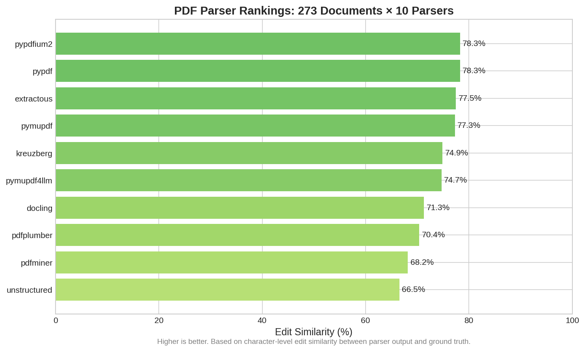
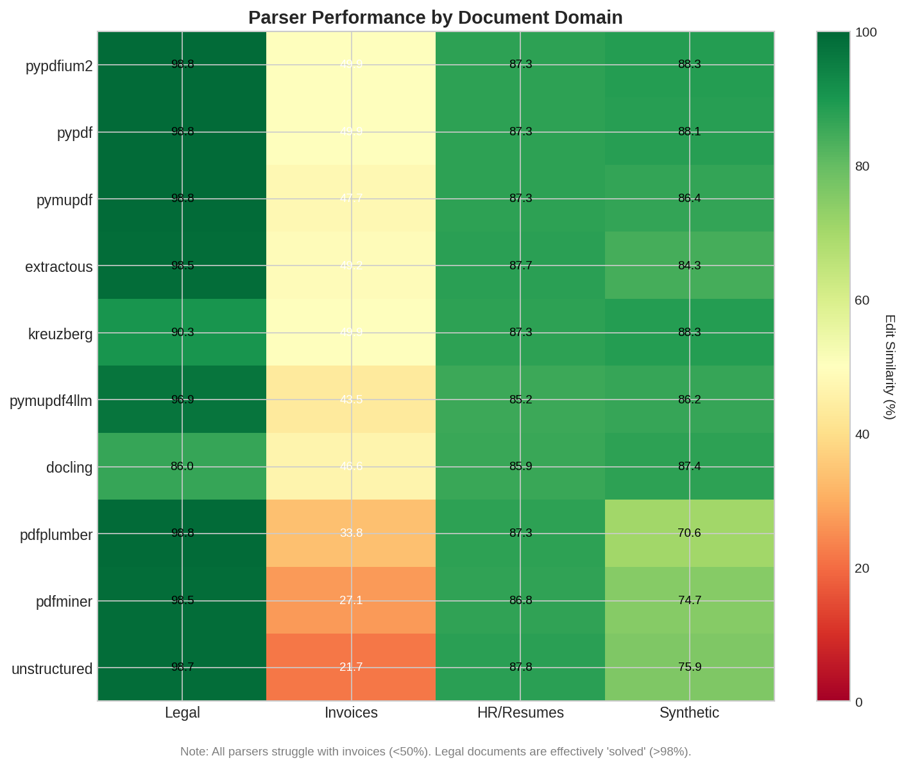
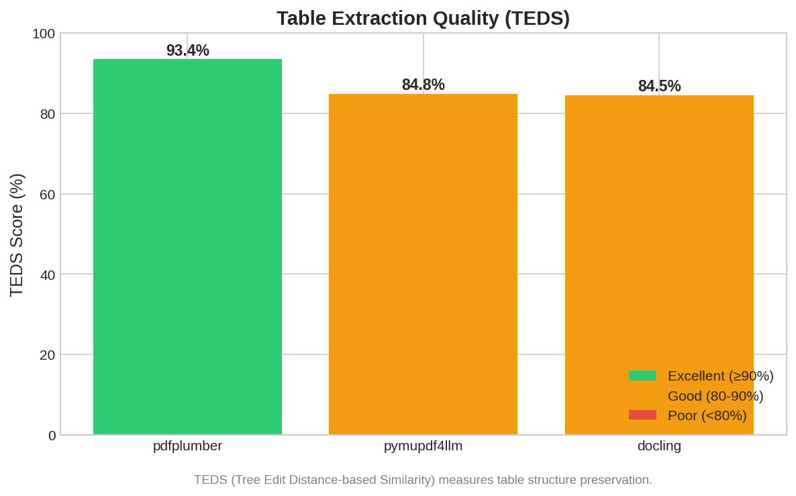
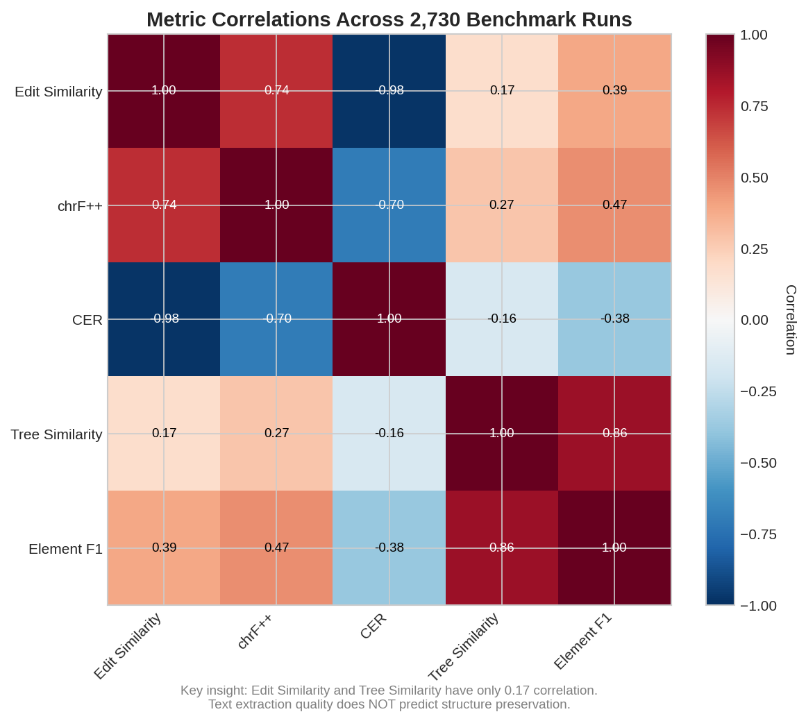

# Comprehensive Evaluation of 10 Open-Source PDF Parsers for Enterprise Document Processing

**TL;DR**: We evaluated 10 open-source PDF parsers across 273 business documents. The results challenge conventional wisdom: the "best" parser depends entirely on your document type. Legal contracts are effectively solved (98.8% accuracy), while invoices remain problematic for all parsers (<50% accuracy).

---

## The Problem: Choosing a PDF Parser Shouldn't Require Guesswork

If you're building a document processing pipeline for contracts, invoices, or compliance documents, you've likely faced this question: *Which PDF parser should I use?*

The typical approach involves:
1. Googling "best PDF parser Python"
2. Finding a blog post from 2019 comparing 3 libraries
3. Trying the one with the most GitHub stars
4. Discovering it fails on your specific documents
5. Repeat

This wastes engineering time and delays projects. Worse, the wrong choice can cascade into downstream issues—corrupted text in your RAG system, broken table extraction, or unreliable document classification.

We built a benchmark to answer this question empirically: **2,730 extraction runs across 10 parsers and 273 documents from four business domains**.

---

## Methodology: How We Evaluated

### The Parsers

We tested 10 open-source PDF parsers, ranging from lightweight text extractors to advanced document understanding systems:

| Parser | Type | Notable Features |
|--------|------|------------------|
| **pypdfium2** | Text extraction | Chrome's PDFium binding, fast |
| **pypdf** | Text extraction | Pure Python, widely used |
| **pymupdf** | Text extraction | MuPDF binding, fast |
| **pymupdf4llm** | Markdown output | Structured output for LLMs |
| **pdfplumber** | Table-focused | Excellent table detection |
| **pdfminer** | Text extraction | Precise positioning |
| **extractous** | Text extraction | Apache Tika binding |
| **kreuzberg** | Text extraction | German NLP focus |
| **docling** | Document understanding | IBM's advanced parser |
| **unstructured** | Document understanding | Layout detection |

### The Documents

Our corpus spans four business document types:

| Domain | Documents | Characteristics |
|--------|-----------|-----------------|
| **Legal (Synthetic)** | 108 | Contracts, NDAs, licensing agreements |
| **Invoices** | 100 | Commercial invoices with complex tables |
| **HR/Resumes** | 34 | Professional resumes, varied layouts |
| **Synthetic Tests** | 31 | Tables, lists, columns, mixed layouts |

### The Metrics

We measured six dimensions of extraction quality:

- **Edit Similarity** (primary): Levenshtein distance normalized to 0-1. Higher = better text accuracy.
- **chrF++**: Character n-gram F-score. Robust to minor text differences.
- **CER**: Character Error Rate. Lower = better.
- **Tree Similarity**: Document structure preservation (heading hierarchy).
- **Element F1**: Precision/recall on document elements.
- **TEDS**: Tree Edit Distance on tables (structure accuracy).

Each parser processed every document, comparing output against manually verified ground truth.

---

## Results: The Overall Rankings



### Overall Performance (Sorted by Edit Similarity)

| Rank | Parser | Edit Sim | chrF++ | CER | Success Rate |
|------|--------|----------|--------|-----|--------------|
| 1 | pypdfium2 | **78.3%** | 90.5 | 21.7% | 100% |
| 2 | pypdf | 78.3% | 90.4 | 21.7% | 100% |
| 3 | extractous | 77.5% | 90.4 | 22.5% | 100% |
| 4 | pymupdf | 77.3% | 90.5 | 22.7% | 100% |
| 5 | kreuzberg | 74.9% | 87.5 | 25.1% | 100% |
| 6 | pymupdf4llm | 74.7% | 86.1 | 26.8% | 100% |
| 7 | docling | 71.3% | 87.5 | 32.2% | 97.4% |
| 8 | pdfplumber | 70.4% | 91.6 | 43.0% | 100% |
| 9 | pdfminer | 68.2% | 89.1 | 31.8% | 100% |
| 10 | unstructured | 66.5% | 87.4 | 34.5% | 100% |

**First surprise**: Simple text extractors (pypdfium2, pypdf) outperform "advanced" document understanding systems (docling, unstructured) on overall accuracy.

But this hides the real story.

---

## The Real Story: Domain Performance Varies Dramatically



### Domain-Specific Performance (Edit Similarity %)

| Parser | Synthetic | Legal | Invoices | HR/Resumes |
|--------|-----------|-------|----------|------------|
| pypdfium2 | 87.5% | **98.8%** | 49.9% | 87.3% |
| pypdf | 87.4% | **98.8%** | 49.9% | 87.3% |
| pymupdf | 85.4% | **98.8%** | 47.7% | 87.3% |
| pdfplumber | 67.4% | **98.8%** | 33.8% | 87.3% |
| kreuzberg | 87.5% | 90.3% | **49.9%** | 87.3% |
| docling | 87.4% | 86.0% | 46.6% | 85.9% |
| unstructured | 73.3% | 98.7% | 21.7% | **87.8%** |

### Key Finding #1: Legal Documents Are "Solved"

Four parsers achieve **98.8% accuracy** on legal contracts: pypdfium2, pypdf, pymupdf, and pdfplumber.

Why? Legal documents are highly structured, text-heavy, and consistently formatted. They play to parser strengths.

**Recommendation**: For contract intelligence, use the fastest reliable option. pypdfium2 or pymupdf deliver near-perfect accuracy at high speed.

### Key Finding #2: The Invoice Problem

**No parser exceeds 50% accuracy on invoices.** The best (kreuzberg, pypdfium2, pypdf) achieve only 49.9%.

This represents a **49 percentage point gap** from the same parser's performance on legal documents.

Why invoices are hard:
- Complex table layouts with merged cells
- Mixed content (logos, text, numbers, barcodes)
- Variable formats across vendors
- Dense information in small spaces

**Implication**: Invoice processing requires specialized solutions—either dedicated invoice ML models or LLM-based post-processing. Generic PDF parsers are insufficient.

### Key Finding #3: Rankings Shift by Document Type

The "best" parser changes based on what you're extracting:

- **Legal contracts**: pypdfium2, pypdf, pymupdf, pdfplumber (tie)
- **Invoices**: kreuzberg, pypdfium2, pypdf (marginal differences)
- **HR documents**: unstructured (87.8%)
- **Mixed layouts**: kreuzberg (most consistent)

**Implication**: Benchmark on your actual documents, not generic test sets.

---

## Table Extraction: A Different Leaderboard



For table-heavy documents, TEDS (Tree Edit Distance Similarity) measures structural accuracy:

| Parser | TEDS Score |
|--------|------------|
| pdfplumber | **93.4%** |
| pymupdf4llm | 84.8% |
| docling | 84.5% |

**pdfplumber dominates table extraction** despite ranking 8th in overall text accuracy. This demonstrates why single-metric comparisons are misleading.

Most text extraction parsers (pypdfium2, pypdf, pymupdf) don't attempt table structure recognition at all—they extract text but lose the table layout.

---

## The Structure Preservation Gap



### Correlation Analysis

| Metric Pair | Correlation |
|-------------|-------------|
| edit_similarity ↔ CER | **-0.978** |
| edit_similarity ↔ chrF++ | **0.739** |
| edit_similarity ↔ tree_similarity | **0.174** |

The **0.174 correlation between text accuracy and structure preservation** reveals an industry-wide problem:

- Parsers optimized for text extraction don't preserve document structure
- Average text accuracy: 73.7%
- Average structure preservation: 35.2%
- This is a **~50% gap**

For RAG applications requiring heading hierarchy, section boundaries, or semantic structure, text accuracy alone is insufficient.

---

## Parser Consistency: Hidden Variance

Some parsers perform consistently across domains; others are volatile:

| Parser | Cross-Domain Variance | Assessment |
|--------|----------------------|------------|
| kreuzberg | 16.7% | Most consistent |
| docling | 16.9% | Very consistent |
| extractous | 18.4% | Consistent |
| unstructured | **29.7%** | Highly variable |
| pdfminer | 27.7% | Variable |

**Why this matters**: A parser that scores 80% on your test set but varies ±30% across domains may fail catastrophically on documents you haven't tested.

For production systems, consistency often matters more than peak performance.

---

## Recommendations by Use Case

### Contract Intelligence / Legal Document Processing

**Recommended**: pypdfium2 or pymupdf

- 98.8% accuracy on contracts
- 100% reliability (no failures)
- Fast processing speed
- No need for advanced parsers

### Invoice Processing

**Recommended**: Custom solution required

- No open-source parser exceeds 50% accuracy
- Options:
  - Specialized invoice ML models (LayoutLM, Donut)
  - LLM-based extraction with post-processing
  - Commercial APIs (Azure Document Intelligence, Google Document AI)

### Resume/HR Document Processing

**Recommended**: unstructured or extractous

- 87.8% and 87.7% respectively
- Similar performance across parsers
- Consider layout-aware options for structured extraction

### RAG/LLM Applications Needing Structure

**Recommended**: docling or pymupdf4llm

- Better structure preservation (61%+ vs 30% average)
- Trade-off: docling has 2.6% failure rate
- Consider multi-parser pipelines for reliability

### Table-Heavy Documents

**Recommended**: pdfplumber

- 93.4% TEDS score
- Purpose-built for table extraction
- Lower overall text accuracy (70.4%) but superior table handling

---

## What We Learned

### 1. Generic Benchmarks Are Misleading

Our 31-document synthetic test showed docling leading at 87.4%. The full 273-document benchmark revealed pypdfium2 at 78.3%—a completely different ranking.

Real-world documents expose parser weaknesses that synthetic tests miss.

### 2. Domain Matters More Than Parser Choice

The same parser varies 49 percentage points between legal (98.8%) and invoice (49.9%) documents. Optimizing parser selection provides marginal gains compared to domain-specific tuning.

### 3. Text Accuracy ≠ Structure Quality

The 0.174 correlation between edit_similarity and tree_similarity means optimizing for text extraction doesn't help structure preservation. These are separate problems requiring separate solutions.

### 4. Reliability Is Undervalued

docling achieves impressive accuracy but has a 2.6% failure rate. For batch processing, this means ~26 failures per 1,000 documents—requiring manual review or fallback logic.

pypdfium2 and pypdf achieve 100% reliability with competitive accuracy.

---

## Reproduction

All code and data are available at [repository link]:

```bash
# Install dependencies
uv pip install -e .

# Run benchmark
pdfbench run benchmarks/full_corpus_353docs.yaml --output results/output.json

# Generate visualizations
python scripts/generate_visualizations.py
```

The benchmark uses:
- 273 documents across 4 business domains
- Ground truth from authoritative HTML/source conversions
- 6 metrics measuring different quality dimensions

---

## Conclusion

PDF parser selection is not a one-size-fits-all problem. Our 2,730-run benchmark demonstrates that:

1. **Simple parsers excel on simple documents** (legal contracts: 98.8%)
2. **All parsers struggle with complex documents** (invoices: <50%)
3. **Rankings change by domain**—benchmark on your actual documents
4. **Text accuracy and structure preservation are separate problems**

For production deployments, test on representative samples from your document population. Generic benchmarks—including this one—can only point you in the right direction.

The "best" parser is the one that works for your documents.

---

*This analysis is part of a series on PDF parser evaluation. See also: [The 50% Structure Gap Problem](#) | [Why Parser Rankings Change by Document Type](#)*
